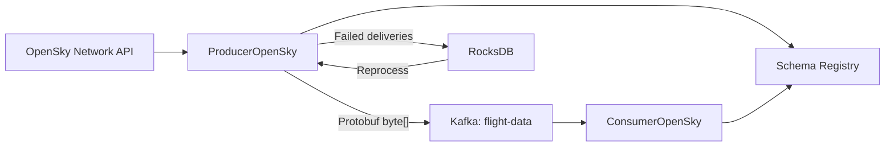

# OpenSky Flight Pipeline

A .NET 9 streaming pipeline that retrieves live aircraft state data from the OpenSky Network, serializes it with Protocol Buffers, publishes it to Apache Kafka, and consumes it from a Kafka consumer group.

## Overview

The project contains two console/worker applications:

- **ProducerOpenSky** — queries the OpenSky REST API, maps each flight state to a Protobuf `FlightState`, publishes messages to the `flight-data` Kafka topic, and stores delivery failures in RocksDB for reprocessing.
- **ConsumerOpenSky** — subscribes to the `flight-data` topic, deserializes Protobuf messages through Schema Registry, and logs the received flight information.

The local infrastructure consists of a three-node Confluent Kafka cluster and Confluent Schema Registry.

## Architecture



## Features

- Manual on-demand OpenSky data ingestion
- Geographic bounding-box filtering
- Protobuf serialization for Kafka messages
- Kafka headers containing API timestamp, source, and query parameters
- Three-broker Kafka deployment with replication
- Schema Registry integration
- Retry with exponential backoff for OpenSky API failures
- RocksDB persistence for failed Kafka deliveries
- Interactive reprocessing of failed messages
- Development-mode OpenSky request and response logging

## Requirements

- Docker and Docker Compose
- .NET SDK 9.0 or later
- Network access to `https://opensky-network.org`
- Windows PowerShell or another compatible terminal

## Project Structure

```text
.
├── docker-compose.yml          # Three Kafka brokers and Schema Registry
├── projeto-streaming.sln       # Solution file
├── ProducerOpenSky/
│   ├── Worker.cs               # Interactive producer workflow
│   ├── Services/               # OpenSky, Kafka, mapping, and RocksDB services
│   ├── Models/                 # DTOs and Kafka event models
│   └── Protos/                 # Protobuf schema
└── ConsumerOpenSky/
    ├── Worker.cs               # Interactive Kafka consumer workflow
    └── Protos/                 # Protobuf schema
```

## Configuration

The applications use `appsettings.json`, `appsettings.Development.json`, environment variables, and .NET user secrets.

### Kafka producer

Configure `ProducerOpenSky/appsettings.json`:

```json
{
  "KafkaProducer": {
    "BootstrapServers": "localhost:9092,localhost:9094,localhost:9095",
    "MessageTimeoutMs": 5000,
    "Acks": "All",
    "EnableIdempotence": true,
    "BatchNumMessages": 50,
    "LingerMs": 5
  }
}
```

The Kafka cluster exposes the brokers on ports `9092`, `9094`, and `9095` from the host machine.

### OpenSky API

The default configuration queries a bounding box covering a region that includes southern Brazil:

```json
{
  "OpenSky": {
    "BoundingBox": {
      "Lamin": "-35.546753",
      "Lomin": "-61.369629",
      "Lamax": "-26.013595",
      "Lomax": "-47.746582"
    },
    "OpenSkyParameters": {
      "extended": "1"
    },
    "OpenSkyUrl": "https://opensky-network.org/api/states/all",
    "OpenSkyTopic": "flight-data",
    "MaxRetries": 3
  }
}
```

Update these values to change the monitored region or topic.

### Failed-message storage

```json
{
  "EventFailureRepository": {
    "BasePath": "rocksdb_data"
  }
}
```

RocksDB data is stored beneath the producer application's base directory.

### Schema Registry

Both applications use:

```json
{
  "SchemaRegistry": {
    "Url": "http://localhost:8081"
  }
}
```

## Getting Started

### 1. Start Kafka infrastructure

From the repository root:

```powershell
docker compose up -d
```

Verify that the containers are running:

```powershell
docker compose ps
```

The endpoints are:

| Service | Host endpoint |
|---|---|
| Kafka broker 1 | `localhost:9092` |
| Kafka broker 2 | `localhost:9094` |
| Kafka broker 3 | `localhost:9095` |
| Schema Registry | `localhost:8081` |

### 2. Restore dependencies

```powershell
dotnet restore projeto-streaming.sln
```

### 3. Run the producer

Open a terminal at the repository root:

```powershell
dotnet run --project ProducerOpenSky
```

Producer commands:

- **S** — fetch and publish the current OpenSky data
- **R** — reprocess messages saved in RocksDB
- **Q** — stop the producer

### 4. Run the consumer

Open a second terminal:

```powershell
dotnet run --project ConsumerOpenSky
```

Consumer commands:

- **S** — consume one message with a 20-second timeout
- **Q** — stop the consumer

A consumed flight is logged with ICAO24 and origin country information.

## Running in Visual Studio

Open `projeto-streaming.sln`, set the producer and consumer projects to start together, and launch them in **Development** configuration. Docker Compose must be started separately.

## Message Format

Messages use the `flight-data` Kafka topic. The key is the aircraft's ICAO24 identifier, and the value is a Schema Registry/Protobuf-encoded `FlightState`. Using `ICAO24` as the partition key guarantees strict chronological ordering per aircraft within the same partition.

The topic is configured for three partitions and a replication factor of `3`, with `min.insync.replicas = 2`. This provides partition distribution across the three brokers while requiring two in-sync replicas for acknowledged writes.

The Protobuf message includes fields such as:

- ICAO24 and callsign
- Origin country
- Position and altitude
- Velocity and heading
- Vertical rate
- On-ground and SPI flags
- Squawk code
- Position source and aircraft category
- Sensors

The Kafka message includes headers for:

- OpenSky API Unix timestamp
- `opensky_api` source
- Applied request parameters

## Reliability Behavior

- OpenSky requests are retried up to `MaxRetries` times with exponential backoff.
- Kafka delivery uses `Acks=All` for acknowledgement from all in-sync replicas and stores delivery failures locally through RocksDB.
- Producer idempotence is enabled with `EnableIdempotence=true`; this configures Kafka's producer idempotence feature to deduplicate identical broker retries.
- Press **R** in the producer to retry failed deliveries.
- Successfully reprocessed messages are removed from RocksDB.
- The consumer starts from the earliest offset (`AutoOffsetReset=Earliest`) for new consumer groups.
- The consumer currently enables automatic offset commits (`EnableAutoCommit=true`); offsets are therefore managed by the Kafka consumer rather than by a manual `EnableAutoOffsetStore=false`/`StoreOffset()` workflow. This configuration can provide at-least-once delivery behavior, but it should not be described as effectively exactly-once processing end to end.

## Future Improvements / Roadmap

- **Continuous Background Ingestion:** Replace the manual `S`/`R` key triggers with a `PeriodicTimer`-based scheduler and dynamic handling of OpenSky API rate limits.
- **Sink & Idempotent Storage:** Persist consumed records in PostgreSQL/TimescaleDB or Delta Lake using upserts keyed by `(icao24, time_position)` to move toward end-to-end effectively exactly-once processing.
- **Dead Letter Queue (DLQ):** Route Protobuf deserialization failures and `ConsumeException` messages to a `flight-data-dlq` topic instead of interrupting the consumer loop.
- **Operational Automation:** Add topic provisioning, schema compatibility checks, metrics, and container health orchestration for the producer and consumer.

## Stopping the Infrastructure

```powershell
docker compose down
```

To remove the Kafka containers and persistent Docker volumes:

```powershell
docker compose down -v
```

## Troubleshooting

### Kafka is unavailable

Confirm all brokers are healthy:

```powershell
docker compose ps
docker compose logs kafka-1 kafka-2 kafka-3
```

Wait until the broker health checks pass before starting the applications.

### OpenSky returns HTTP 429

The OpenSky API rate limit may have been reached. Wait before requesting new data. Development mode also reports response headers, including available rate-limit information.

### Topic or message is not available

Confirm that Schema Registry is running on port `8081` and that the producer has successfully published at least one message. The producer can create the `flight-data` topic through Kafka's normal topic auto-creation behavior.

### Failed messages are retained

Use the producer's **R** command to reprocess the RocksDB queue. Check the producer logs for delivery errors and Kafka connectivity issues.
